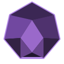

# Obsidian Game Engine

Obsidian Game Engine is a customized fork of the [Godot Engine](https://godotengine.org),
an open-source engine for creating 2D and 3D games. This fork keeps Godot's
upstream attribution and licensing; upstream documentation and contribution
links below refer to the original project.

  

## 2D and 3D cross-platform game engine

**Obsidian Game Engine** is a feature-packed, cross-platform fork of Godot for
creating 2D and 3D games from a unified interface. It builds on Godot's
comprehensive set of [common tools](https://godotengine.org/features), so users
can focus on making games without having to reinvent the wheel. Games can be
exported to major desktop platforms (Linux, macOS, Windows), mobile platforms
(Android, iOS), the Web, and [consoles](https://godotengine.org/consoles).

## Free, open source and community-driven

Obsidian Game Engine is free and open source under the [MIT license](LICENSE.txt),
inheriting Godot's permissive licensing. Games made with the engine belong to
their creators. The fork builds on Godot's independent, community-driven
development, supported by the [Godot Foundation](https://godot.foundation/).

Before being open sourced in [February 2014](https://github.com/godotengine/godot/commit/0b806ee0fc9097fa7bda7ac0109191c9c5e0a1ac),
Godot had been developed by [Juan Linietsky](https://github.com/reduz) and
[Ariel Manzur](https://github.com/punto-) for several years as an in-house
engine, used to publish several work-for-hire titles.

## Getting the engine

### Binary downloads

Official binaries for the Godot editor and the export templates can be found
[on the Godot website](https://godotengine.org/download).

### Compiling from source

[See the official docs](https://docs.godotengine.org/en/latest/engine_details/development/compiling)
for compilation instructions for every supported platform.

## Community and contributing

Godot is not only an engine but an ever-growing community of users and engine
developers. The main community channels are listed [on the homepage](https://godotengine.org/community).

The best way to get in touch with the core engine developers is to join the
[Godot Contributors Chat](https://chat.godotengine.org).

To get started contributing to the project, see the [contributing guide](CONTRIBUTING.md).
This document also includes guidelines for reporting bugs.

## Documentation and demos

The official documentation is hosted on [Read the Docs](https://docs.godotengine.org).
It is maintained by the Godot community in its own [GitHub repository](https://github.com/godotengine/godot-docs).

The [class reference](https://docs.godotengine.org/en/latest/classes/)
is also accessible from the Godot editor.

We also maintain official demos in their own [GitHub repository](https://github.com/godotengine/godot-demo-projects)
as well as the [Asset Store](https://store.godotengine.org/).

There are also a number of other
[learning resources](https://docs.godotengine.org/en/latest/community/tutorials.html)
provided by the community, such as text and video tutorials, demos, etc.
Consult the [community channels](https://godotengine.org/community)
for more information.

